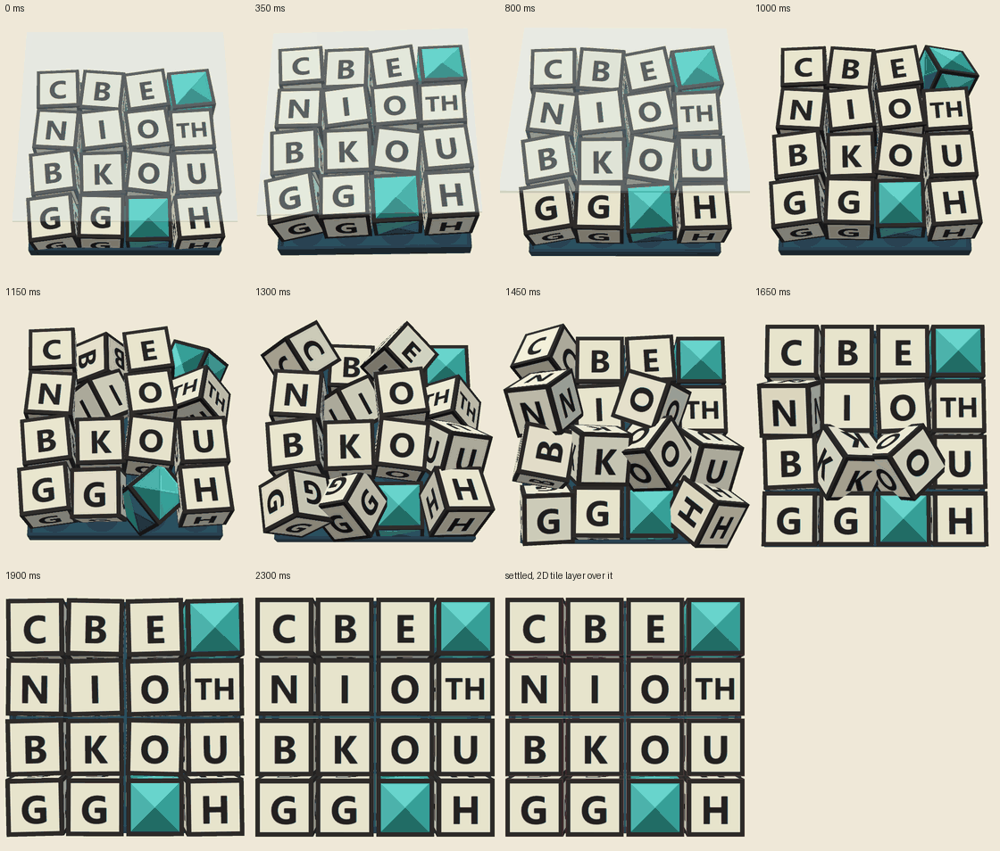

# Shake prototype

The board scene of [Board](board.md#the-shake-and-the-drop), built in Qt Quick 3D
behind its one-component seam, and what it cost on one desktop. A prototype:
it answers "can it be done, what does it cost, and what must the seam say", and
it is not the game's board.

**Nothing here was measured on an iPad, or on any tablet or phone.** The shared
Qt tree has no iOS kit, so the prototype could not be built for one. Every
figure is from one Windows desktop (below), and the multiple to a tablet is
still the estimate [Performance](performance.md#budgets) already makes.

**Licence.** A build that links Qt Quick 3D is **GPL-3.0 only**: Qt offers
`Quick3D` as `LicenseRef-Qt-Commercial OR GPL-3.0-only` (SBOM, checked in
[Board](board.md#rendered-3d-or-drawn-in-2d)). `ShakePrototype` links it, so it
is GPL-3.0 only, and it is a program of its own so that `WordJewelsSolver`
does not. The decision stands as the author made it on 2026-10-16: the MVP is
a private build, and D2 is taken before any store, with the seam in hand.

**Checked, not changed:** with the option off nothing links Qt Quick 3D and no
`Qt6Quick3D.dll` is deployed. But the application's deploy directory already
holds `Qt6Quick3DUtils.dll` (also GPL-3.0 only in the SBOM), because
`windeployqt` copies the QML debugger's `qmltooling\qmldbg_quick3dprofiler.dll`,
which depends on it. The application does not link it and the plugin loads only
when QML debugging is switched on, but it is in the folder that would ship.
`windeployqt --skip-plugin-types qmltooling` would keep it out; that is the
platform fragment's to change, not this page's, and is left for the author.

## What was built

| Part | Where | What it is |
| --- | --- | --- |
| The scene | `src/app/prototype/shake/qml/BoardScene.qml` | The component: a `View3D`, the box, the lid, one `Model` for each die sharing the `#Cube` mesh, a letter atlas, a baked light probe. Draws the poses the script gives it |
| The script | `qml/ShakeScript.js` | The shake, lid, drop and settle as a function of the board, the seed and the time. Plain JavaScript, no QML and no renderer |
| The faces | `qml/FaceAtlas.qml`, `qml/Die.qml` | One texture for the board's tiles, each die sampling its own cell; a dead jewel is a cell of four facets |
| The harness | `qml/ShakeWindow.qml`, `frame_stats.*`, `main.cpp` | A window with a Shake button, a mouse drag standing in for the accelerometer, a reduced-motion switch, a 2D tile layer over the scene, and the timing and measurement runs |
| The probe | `tools/lightprobe`, `qml/lightprobe/sky.ktx` | Qt's procedural sky prefiltered in advance (128 x 128 texels a face, 1 MB), made by Cubeulator's tool over the same sky |

It is behind `-DWJS_BUILD_SHAKE_PROTOTYPE=ON`, off by default, and the default
build is unchanged: the option adds one program and finds one more Qt module.
The scene has no game rules in it: a tile is an opaque string and `""` is a dead
jewel.

### The interface

| Member | Kind | Meaning |
| --- | --- | --- |
| `play(board, seed)` | function | Shake, lid, drop, settle, for `board = { rows, columns, tiles }`. The dice are in the box at the first frame |
| `show(board)` | function | The board already down, with no motion: a resumed game, a rotated window |
| `reducedMotion` | in | The cross-fading variant of every stage |
| `agitation` | in | 0 to 1, how hard the device is being shaken now. Holds the rattle on past 0.7 s, up to 3 s |
| `tilt` | in | A vector, each axis -1 to 1. Leans the box within the 8 degrees |
| `settled()` | signal | Once per play, when the dice have stopped |
| `landed(index, pitch)` | signal | A die has hit the floor: its place in the board, and a pitch for its click |
| `rattled()` | signal | The box rattles, at most 8 a second, for the haptic tap |
| `busy`, `rows`, `columns`, `tileSize`, `tileGap`, `boardRect` | read-only | The geometry by [the rule](board.md#the-rule), for the 2D layer that traces over the scene |

`lean`, `probeMode`, `cameraDistance` and `warmUp` are settings of the 3D
implementation and are not part of the seam. `seek(board, seed, ms)` and
`digest(board, seed)` are for tests and pictures.

### The stages as built

All are [the starting values](board.md#the-stages), unchanged. The drop is a
seeded shuffle, the gap between starts is the smaller of 30 ms and 700 ms over
the dice, each fall takes 280 to 420 ms with a rebound of an eighth of the
height, and the camera comes upright over the drop and the settle so that the
dice's tops are the 2D tiles.

| Play | Measured, play to `settled` | What it is |
| --- | --- | --- |
| 4x4, full motion | 1.97 s | 0.70 shake, 0.25 lid, 0.87 drop, 0.15 settle: 1.27 s after the shake, 1.65 s with the 380 ms layout stage that is the application's, not the scene's |
| 3x3, full motion | 1.73 s | The same, with 9 dice starting 30 ms apart |
| Either, reduced motion | 0.58 s | 0.30 rattle, 0.12 lid fade, 0.12 dice fade |
| Rattle held at full | 4.0 s (3x3), 4.3 s (4x4) | The 3 s limit, then the lid and the drop |

## How it was measured

| | |
| --- | --- |
| Machine | Windows 11 Pro for Workstations 10.0.26200; AMD Ryzen 9 5950X (16 cores, 32 threads); NVIDIA GeForce RTX 4090 (driver 32.0.16.1742). Shared with other work, not quiesced |
| Renderer | Qt RHI on Direct3D 11, threaded render loop, flip-model swap chain, MSAA Medium. Qt reports the window's display at 60 Hz (a vsync of 16.68 ms) |
| Software | Qt 6.12.0 (`msvc2022_64` of the shared tree), MSVC 19.51, Release (`/O2`), QML compiled to C++ ahead of time |
| Window | 560 x 900 logical pixels, the scene in the top two thirds |
| Also tried | Qt's bundled Mesa llvmpipe through OpenGL (`QSG_RHI_BACKEND=opengl`, `QT_OPENGL=software`), as a stand-in for a device with a weak GPU; **not** a model of an iPad |

Frame times are the interval between `frameSwapped` signals. The render thread's
CPU time for a frame is `beforeFrameBegin` to `afterFrameEnd`; **it is the time
spent recording and submitting the frame, not the GPU's.** GPU time was not
measured. With a 60 Hz display every interval is near 16.7 ms, so "over 16.7 ms"
counts about 40% of all frames by a fraction of a millisecond. A missed refresh
is an interval of 25 ms or more, so the tables give over 20, 25 and 33 ms.

```powershell
cmake --preset windows-msvc-release -DWJS_BUILD_APP=ON -DWJS_BUILD_SHAKE_PROTOTYPE=ON
cmake --build --preset windows-msvc-release --target wjs_shake_prototype
$env:QT_ASSUME_STDERR_HAS_CONSOLE = 1      # the program is a GUI program; this shows its log
build\windows-msvc-release\bin\ShakePrototype.exe                       # to play with
build\windows-msvc-release\bin\ShakePrototype.exe --auto --runs 6 --out results   # timing
build\windows-msvc-release\bin\ShakePrototype.exe --auto --shots --out shots      # stills
build\windows-msvc-release\bin\ShakePrototype.exe --auto --digest --out digest    # replay check
```

## What it cost

### Making the view

| | Cold pipeline cache | Warm cache |
| --- | --- | --- |
| Load `BoardScene.qml` (the Quick 3D module, the component) | 14 to 17 ms | 14 ms |
| Create it (`createObject`: the `View3D`, 16 dice, their materials) | 3 ms | 3 ms |
| First frame after that, to the swap | 454 ms (447 ms of it on the render thread) | 214 ms |
| The same with the first-shake warm-up off | 411 ms | 171 ms |

Cubeulator measured about 140 ms to create each of its cube views
([Board](board.md#rendered-3d-or-drawn-in-2d)); here the objects are made in
3 ms and **the cost is the first frame**, which is Qt Quick 3D generating and
compiling the shaders of the materials, once, at run time. The cache is the
pipeline cache Qt writes beside the application's data; a hot one is about half
the cold. The driver keeps its own, which was not cleared. **So the view is
made once, behind the home screen, and not on the press of Shake.**

### The first shake

The first play of a process is a different case, because a path that is only
drawn while things move (the translucent lid, the shadows, a die with an
opacity) has not been used yet.

| First shake of the process | Press to first frame | Render-thread time of that frame | Next five frames |
| --- | --- | --- | --- |
| No warm-up | 47.7 ms | 42.4 ms | 1.2, 4.2, 8.2, 10.9, 4.0 ms |
| With the warm-up | 17.9 ms | 1.1 ms | 0.9, 0.3, 1.0, 0.4, 0.3 ms |

The warm-up is three frames at 2% opacity of the lid, shadows and dice, drawn
once while the first board is shown. (The first try, at 0.4%, did nothing: Qt
does not draw below some small opacity, and the threshold was not looked up.)
It moves about 40 ms into the creation frame above. The 47.7 ms without it is
the only frame on Direct3D 11, after the scene was made, over the
[33 ms budget](performance.md#budgets).

### During the shake and the drop

All the plays of three processes, each process's first play left out
(see above), 9,337 frames; Direct3D 11, the baked probe, the warm-up on.

| Play | Plays | Frames | Interval p50 / p99 / max | Over 20 / 25 / 33 ms | Render thread mean / max |
| --- | --- | --- | --- | --- | --- |
| 3x3 full | 15 | 1,545 | 16.7 / 17.2 / 17.8 ms | 0 / 0 / 0 | 0.35 / 0.92 ms |
| 4x4 full | 18 | 2,112 | 16.7 / 17.4 / 19.8 ms | 0 / 0 / 0 | 0.45 / 1.45 ms |
| 3x3 rattle held 3 s | 9 | 2,161 | 16.7 / 17.3 / 20.0 ms | 0 / 0 / 0 | 0.40 / 1.38 ms |
| 4x4 rattle held 3 s | 9 | 2,296 | 16.7 / 17.2 / 19.6 ms | 0 / 0 / 0 | 0.47 / 1.50 ms |
| 3x3 reduced | 18 | 612 | 16.7 / 17.2 / 18.1 ms | 0 / 0 / 0 | 0.29 / 0.74 ms |
| 4x4 reduced | 18 | 611 | 16.7 / 17.3 / 19.5 ms | 0 / 0 / 0 | 0.38 / 1.02 ms |

On this machine the scene is far inside its frame: no frame was late, the
render thread spends about half a millisecond on a frame, and the longest
interval was 20 ms. That says nothing about a tablet's GPU, which does the work
the render thread only submits. The two things to measure on the device are the
GPU time of a frame with 16 dice and MSAA, and the first-frame cost above.

### Replay

`--auto --digest` checksums every pose of a play, frame by frame at 60 Hz with
the device still. The same board and seed gave the same checksum twice, a
different seed a different one, and reduced motion its own:

| Board | Seed 100, then again | Seed 101 | Reduced, seed 100, then again |
| --- | --- | --- | --- |
| 3x3 | `7cfdfd74`, `7cfdfd74` | `c5dc0064` | `4a2172c5`, `4a2172c5` |
| 4x4 | `ea3b8ceb`, `ea3b8ceb` | `cd5e72f7` | `e5250505`, `e5250505` |

Moving the script out of the scene file into `ShakeScript.js` left the stills
identical, pixel for pixel but one pixel one level off. What the checksum does
not cover is the rattle's response to a live `agitation`, which is the one live
part by design.

### The drag

A mouse drag stands in for the accelerometer: where the pointer is in the scene
sets `tilt`, how fast it moves sets `agitation`, and the agitation decays when
it stops. One measured play sent the window a scripted back-and-forth pointer
path for two seconds (`dragBetween`, so the pointer path through the scene is
exercised without a hand): the peak agitation reached 1.0 and the tilt 0.7, the
box rattled for 2.3 s instead of 0.7 s (3.6 s play against 1.97 s), and no frame
was over 20 ms. The same hold with the agitation set directly is the "rattle
held" rows above. The first version read the speed from the handler's own
velocity, which a scripted event does not carry (peak 0.19); it is now computed
from where the pointer was and when.

### The light probe

| Probe | Cost on Direct3D 11 | On the software renderer |
| --- | --- | --- |
| None | First frame 356 ms (cold); a flatter look | Runs |
| Prefiltered at run time (Qt's sky) | +33 ms to create it; first frame 400 and 586 ms in two cold runs | **Never finished a run** in 4 minutes (twice): Qt's pre-filter pipeline failed to build, 2,813 times (below) |
| Baked in advance (the file) | None: first frame 410 and 419 ms in two cold runs | Runs |

On a GPU it does not matter to the cost, as for Cubeulator. On a software
renderer it decides whether the scene draws at all. Against the run-time probe
the baked file's pictures differ by at most 3 of 255 in a channel (mean 0.01 to
0.09), which is not visible; against no probe they differ by up to 43, mean 6,
because the ambient light is missing. **The probe is baked in advance, 1 MB.**

### The software renderer

Qt's bundled Mesa llvmpipe through OpenGL (Mesa 11.2.2, a GL 3.0 context), two
plays of each, the baked probe. A stand-in for a device with no GPU to speak
of; it is **not** a model of an iPad's GPU, and shows only which parts of the
scene cost the most when the pixels are the bottleneck.

| Play | Frames | Interval p50 / p99 / max | Over 20 / 25 / 33 ms | Render thread mean / max |
| --- | --- | --- | --- | --- |
| 3x3 full | 215 | 16.0 / 18.4 / 20.6 ms | 1 / 0 / 0 | 10.3 / 14.8 ms |
| 4x4 full | 229 | 17.1 / 22.3 / 24.0 ms | 26 / 0 / 0 | 13.6 / 20.8 ms |
| 3x3 rattle held | 505 | 15.9 / 18.2 / 28.3 ms | 1 / 1 / 0 | 10.8 / 14.5 ms |
| 4x4 rattle held | 514 | 16.6 / 19.2 / 20.1 ms | 1 / 0 / 0 | 12.8 / 16.7 ms |
| 3x3 reduced | 68 | 16.2 / 56.2 / 122.9 ms | 2 / 1 / 1 | 12.4 / 112.7 ms |
| 4x4 reduced | 55 | 20.4 / 28.3 / 29.7 ms | 31 / 4 / 0 | 16.3 / 24.8 ms |

The first frame after creating the scene took 0.9 s (0.8 s with no probe).
A frame is 10 to 14 ms of the CPU's rasterising, so 60 Hz is held at 3x3 and
almost at 4x4. The reduced-motion plays are the heaviest, which is the part of
the scene drawn blended, and one frame of the 3x3 reduced plays took 123 ms
(85 ms with no probe): the warm-up did not remove it on this renderer.

**The run-time probe did not work on it.** The pre-filter's shaders were not
there for the GLSL this context accepts (it looked for 130 and 120; the file
has 100, 150 and 300 es), so Qt logged "No GLSL shader code found" and "failed
to create pre-filter env map pipeline state" 2,813 times in 4 minutes, and the
run never produced a result (the first attempt, with a 280 s limit, did not
either). This is a limit of that Mesa and not of CPU renderers in general
(Cubeulator got 10 to 16 s on another Mesa). What it shows is that a probe
prefiltered at run time can stop the scene drawing where the GL is old, and a
file cannot. The baked probe ran on it as above.

## What it looked like



Stills at fixed times of one board (`--auto --shots`), so they are the same on
every run. They were read from stills by whoever built the scene, not by a
child, and nobody has yet watched the motion: that is the author's to judge by
running it.

- **At rest it reads well**, at 3x3 and 4x4. Letters upright, cream face and
  dark edge, the dead jewels distinct, and the 2D layer's outlines sit on the
  dice's tops to the pixel (the hairlines in the last frame are the 2D layer;
  it draws a hovered tile amber, as in the second strip below).
- **The rattle reads as a box.** With the camera leaning 24 degrees the dice
  are plainly inside a tipping tray under a pane (350 and 800 ms).
- **The drop reads as dropping.** In a seeded order, each die turns about its
  horizontal axes as it falls and settles with a small rebound; a letter is on
  every face, so a tumbling die is always a letter and never a blank. The camera
  coming upright over the fall is what shows the height of the fall in the
  stills.
- **Straight down is worse than leaning.** With `--lean 0` the dice, at the
  height of the box, are about a tenth bigger on the screen than a tile, which
  is more than the 12 dp inset, so the rattle and the start of the drop are
  cropped by the item's edge, and the box does not read as a box: 
- **What is wrong with it.** There is no collision, so a falling die cuts
  through a landed neighbour for a few frames (1450 ms, the O through the K);
  the scene's item is the board's area, so a die that tumbles at the edge is
  cut off by the item's bounds (1300 and 1450 ms, the left edge); and the dead
  jewel is a cube with four facets painted on its faces, which looks wrong from
  the side. The first two want the scene's item to be larger than `boardRect`;
  the third wants a mesh, if D2 goes 3D.

## If a 2D implementation is swapped in

Everything the application knows is the table in [The interface](#the-interface).
What a 2D `BoardScene` has to keep:

1. **The same name and members**, from the same module. QML has no interface
   type, so the contract is the list and a test that loads either file and
   checks it. The build picks the file (two files, one type name, chosen in
   CMake), not a preprocessor test.
2. **The same script.** `ShakeScript.js` has no renderer in it: `create`,
   `advance` and `evaluate` give each die's position, three angles, opacity and
   shadow, and the box, lid and camera. A 2D scene draws that: `px`, `py` as
   `x`, `y`; `pz` as `scale` and the shadow's size and opacity; `rz` as
   `rotation`; `rx` and `ry` dropped, or a skew; the lid as a rectangle that
   fades. Then a replay is the same, the landing order and the clicks are the
   same, and `digest()` is the same string in both.
3. **The same geometry.** `boardRect`, `tileSize` and `tileGap` by the same
   rule, and a die at rest exactly on its tile, since the tile layer, the path
   and the panel are 2D in both and do not move.
4. **The same events.** One `settled()` for a play, after `busy` is true and
   before it is false; `landed(index, pitch)` from the script; `rattled()` at
   most 8 a second; `play()` while busy restarts; `show()` makes no motion and
   emits nothing.
5. **The same inputs, the same meaning.** `agitation` and `tilt` change how
   hard and how long the box rattles and never where a die lands;
   `reducedMotion` takes the cross-fading path of every stage, 0.54 s in all.

What it does not carry: `lean`, `probeMode`, `cameraDistance`, `warmUp`, and
the 3D-only files (`Die.qml`, `FaceAtlas.qml`, the probe). It loses the lit
solid and the true tumble about the horizontal axes; the stages and their
durations are the same.

### What the seam should change

The prototype suggests two changes to the seam before the application is built
on it, both cheap now:

- The scene's item should be allowed to be larger than the board, with
  `boardRect` saying where the board is in it, so that a tumbling die at the
  edge and the box's rim are not cut off.
- The first board's `show()` is where the one-time costs go, so the
  application should create the scene at start-up with the first board and not
  on the first press of Shake. The interface already allows it.

## What was not measured

- **Anything on an iPad, a tablet or a phone**, and the GPU time of a frame on
  any device. The next step is a build for iOS (the shared tree has no kit) and
  Qt's GPU timestamps on the device.
- Power and heat, memory beyond what is noted, and a second desktop GPU.
- A person's hand on the drag. The runs set the agitation directly, and one
  sends the window a scripted back-and-forth pointer path ([above](#the-drag));
  how the drag *feels* is unjudged.
- The accelerometer, haptics and sound. The scene emits `rattled` and `landed`
  and the harness shows a count; no run checked the counts against the script.
- Whether the tumble reads at a child's eye height. See
  [Unknowns](board.md#unknowns).
